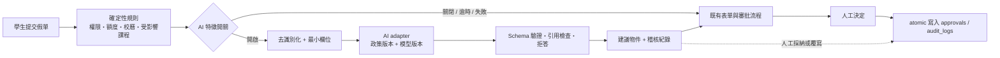

# 智能化路線構思 — Student Absence & Academic Accommodation System

> **狀態｜Status：v1.16.0 規劃文件（2026-11-05）**
>
> 本文件是工程與治理藍圖，**不是已實作功能**。v1.15.0 建立路線，v1.16.0 補上
> [`AI-ETHICS.md`](AI-ETHICS.md) 倫理專章；原型仍然沒有 AI／LLM 執行路徑、沒有模型 API 呼叫、
> 沒有新增第三方依賴，也沒有把學生個資傳出本機。所有審批、額度、權限與受影響課程計算仍是確定性規則。
>
> **兩份文件的分工**：本文件管「**能不能上線**」（資料、能力、工程與熔斷閘門）；
> `AI-ETHICS.md` 管「**該不該這樣做**」（權利、公平、問責、傷害與復權）。
> 本文 §1 的紅線是禁止事項，倫理專章把它們背後的正面義務寫成可勾選的驗收條件。

---

## 0. 核心判斷

智能化不應從「接一個聊天機器人」開始，而應從**可稽核的資料、版本化政策與可撤回的建議層**開始。

本專案處理的是請假、健康證明、課業影響與兩級審批，屬於高影響、含個資、需要申訴與人工覆核的流程。因此路線定為：

> **規則決定事實，AI 只提出建議，人作最終決定，稽核記錄全部過程。**

「AI 上線」的定義不是模型回傳了一段文字，而是：建議可重現、可拒絕、可追溯、可降級，且不會放寬既有權限邊界。

---

## 1. 三層架構與不可跨越的紅線

| 層級 | 職責 | 本專案對應機制 |
|---|---|---|
| **決策層｜Deterministic** | 身份、範圍、額度、天數、校曆、受影響課程、狀態流轉、稽核 | `role_scope()`、`todo_scope()`、`can_view_request()`、`atomic()`、`affected_courses_for()`、`schema.sql`、`backup.py` |
| **建議層｜Advisory** | 文件缺漏提示、事由分類、OCR 欄位擷取、政策檢索、匯總洞察 | 未來獨立的 `AI adapter`；預設關閉、輸出受 schema 限制、失敗即回落到確定性流程 |
| **覆核層｜Human** | 導師／院系作決定、學生要求人工處理、管理員停用功能 | 既有 `approvals`／`audit_logs`，另需記錄建議、模型版本與人工覆寫 |

### 紅線｜Never

- **不自動核准、不自動駁回、不自動改路由**；模型輸出不得直接寫入 `leave_requests.status` 或 `approvals.action`。
- **不讓 AI 放寬存取範圍**：任何建議都先經過原本的 `role_scope()`／`can_view_request()`，不得以「摘要」名義跨導師、跨院系列舉個資。
- **不把原始事由、姓名、電話、證明附件直接送外部模型**；預設最小欄位、去識別化與輸入雜湊。
- **不由模型自由生成政策**：對話式助理只能引用經教務處核定、具版本號的政策文本；查不到即回答「不確定」並轉人工。
- **不預設拿學生資料訓練模型**，不允許服務商保留提示詞與回應作改善用途。
- **不做隱性個人評分**，尤其不得把健康、家庭或請假紀錄轉成懲戒、獎助、簽證或紀律處分依據。
- **不在資料品質、評估、合規與回退演練完成前，把 AI 放進生產審批路徑。**

### 從紅線到倫理義務

紅線只說「不可以做什麼」；**合規通過也不代表學生被公平對待**。
[`AI-ETHICS.md`](AI-ETHICS.md) 補上七項正面義務（人的能動性、比例性、不傷害、公平與包容、
透明與可解釋、私隱與目的限制、問責與可補救），並處理這裡沒展開的幾件事：

- 教育場景的**權力不對等**——拒絕 AI 必須無痕、免理由、不降速、不影響結果；
- 四種即使在模型準確時仍會發生的傷害（分配／代表性／尊嚴／程序）與**標籤回饋迴路**；
- 當事人與審批人的**權利清單**、代理變數、分層解釋與**自動化偏見**的介面約束；
- **問責矩陣**、倫理審查小組的**否決權**、事故分級與**復權**；
- 一份可勾選的**上線前倫理驗收檢核表**，任一項未勾選即 No-Go。

### 與既有預警規則的邊界

`saas/prd.html` §10 定義的 **EW-1～EW-5** 是**提案設計，不是原型已交付能力**：缺席率、連續缺席、
病假模式、考評衝突，以及由 EW-1／EW-2／EW-4 任兩項各自達標所觸發的重複支持跟進。
這些規則必須**透明、採固定門檻、可逐項解釋，並只開立支持性人工跟進任務**；EW-5 不加權、
不產生個人綜合風險分，也不採用 GPA 趨勢或遲交資料。它們屬於 H1 的思維，不是模型評分。

本路線新增的界線是：**不另外引入由模型推導、不可解釋或會對個別學生造成不利效果的風險分**；
EW 規則若日後要改用模型或加入新特徵，就必須重新走 H0 的政策版本、H2 的偏差審查與 DPIA，
且只能用於支持性關懷，不得轉為懲戒、獎助、簽證或紀律處分依據。H3 的匯總洞察同理——只談群體趨勢與資源配置，
不回落到個人名單。

---

## 2. 現在已有的資料基礎，以及真正的缺口

### 2.1 已具備的結構化帳本

| 來源 | 可用訊號 | 智能化用途 | 敏感度 |
|---|---|---|---|
| `leave_requests` | 起訖日、時段、天數、假別、狀態、`current_level`、`affected_courses` | 工作量預測、缺件提示、政策模擬、流程瓶頸分析 | 中；`reason`、`contact_phone`、`attachment` 屬高敏感 |
| `approvals` | 層級、動作、意見、時間 | 一致性分析、SLA 觀察、人工覆寫率 | 中；`comment` 可能含個資 |
| `audit_logs` | 動作、行為者、時間、細節 | 建議前後對照、可追溯性、異常存取偵測 | 中 |
| `users` | 角色、院系、班級、導師歸屬 | 範圍隔離、匯總分群 | 高；姓名、Email 為直接識別資料 |
| `timetable`／`holidays`／`makeup_days` | 逐生課表、假日、補課日 | 衝突提示、補考時段建議、缺課影響說明 | 中 |
| `terms`／`leave_quotas`／`leave_types`／`delegations` | 學期、額度、假別、代理關係 | 規則式檢查、政策模擬 | 低 |
| `notifications` | 通知時間、已讀狀態、摘要待送與認領狀態 | 送達與負擔分析，須尊重 v1.19.0 已交付的 D4 通知偏好 | 中 |

### 2.2 仍缺的工程前置條件

| 前置條件 | 為什麼是 AI 的硬依賴 | 對應缺口 |
|---|---|---|
| **版本化政策登錄** | 沒有政策版本，就無法判斷建議依據的是哪一年的規則；模型升級也無法重現舊結果 | 新工作項 |
| **去識別化唯讀視圖** | 評估與分析不應直接讀 `reason`／附件／電話原文 | 新工作項 |
| **事件與建議稽核模型** | 需要知道「看到什麼建議、誰採納或覆寫、結果如何」 | 新工作項 |
| **Golden set 與離線重放** | 沒有固定案例集，就更換模型或提示詞後無從比較退化 | 新工作項 |
| **唯讀副本／分析層** | 避免評估與模擬拖慢交易資料庫 | A1 |
| **對外事件與 API** | 讓出席、課表、政策系統有正式契約，而非靠人手匯 CSV | E1 |
| **雙語政策語料** | EMI 校園的助理若只懂中文，等於對國際生不可用 | E2 |
| **通知偏好** | 智慧提醒不能變成新一輪訊息轟炸 | D4（v1.19.0 原型已完成；未來 AI 提醒仍須沿用此偏好） |
| **特徵開關與熔斷** | 出事時要能一鍵回到純規則流程，而不是改程式重部署 | 新工作項 |

> `backup.py`（v1.14.0）已提供可驗證的一致性快照與可回退還原，是未來「評估資料集可重現」的地基；但它不是資料治理的替代品。

---

## 3. 建議層的技術契約

未來的 `AI adapter` 應是**無狀態、唯讀、可降級**的邊界服務，不直接寫業務表。



### 3.1 建議物件的最低欄位（提案）

```json
{
  "feature": "reason_triage",
  "request_id": 123,
  "policy_version": "2026-27.1",
  "model_version": "<model-id-or-digest>",
  "prompt_version": "<version>",
  "input_hash": "sha256:<digest>",
  "output_schema_version": "1",
  "suggestion": {
    "category": "<allowlisted-code>",
    "required_documents": ["<allowlisted-code>"],
    "citations": ["<approved-policy-clause-id>"]
  },
  "abstain": false,
  "expires_at": "<UTC timestamp>"
}
```

- 輸出只能是 allowlist 內的列舉值；自由文字不得進入狀態機。
- `abstain=true` 是一等公民：證據不足時必須拒答，而不是猜。
- 輸入原文不長期保存；只存雜湊、欄位摘要與政策／模型版本。
- 建議有 TTL，過期即失效；人工決定後保留「採納／覆寫／忽略」結果供離線評估。

### 3.2 建議新增的資料表（尚未實作）

- `ai_suggestions`：建議物件、輸入雜湊、模型／政策／提示詞版本、TTL、人工處置。
- `ai_eval_cases`：去識別化 golden set、預期輸出、所屬情境與風險標籤。
- `ai_eval_runs`：案例集版本、模型版本、通過／拒答／覆寫結果、審核人。
- `ai_feature_flags`：功能、適用角色、灰度範圍、啟用／停用理由與操作者。

這些表與 `leave_requests` 分離，讓「刪除 AI 建議」不必動到正式請假紀錄；留存期沿用 D1 的 minimization 原則。

---

## 4. 分階段路線｜Capabilities, Gates, Exit Criteria

> H0–H3 是**能力成熟度**，不是日期承諾。每一階段都必須通過 Go / No-Go 閘門；未通過就停留在前一階段。

### H0 · 可信地基｜Trust foundation（本版後優先）

**做什麼**

1. 把審批門檻、假別、所需文件、SLA 寫成版本化政策登錄，程式只讀設定。
2. 建立去識別化唯讀視圖與離線資料集產製流程；禁止把 `reason`／附件原文放進評估集。
3. 建立 golden set、離線重放腳本、基準指標與人工標註指引。
4. 完成 DPIA／資料分級／存放區域／跨境評估，並由資料保護負責人簽核。
5. 完成特徵開關、逾時、熔斷、降級與還原演練；`AI adapter` 仍為空實作。

**離場條件**

- 至少兩個學期的乾淨資料與資料品質報告；欄位缺漏、課表 demo 覆蓋率、政策版本皆有可查數字。
- 既有決策 100% 可追溯到人、時間、規則版本；沒有任何模型呼叫進入生產路徑。
- 關閉 AI 後，完整 pytest、smoke、備份還原演練仍全綠。

**為何先做**：沒有這一層，日後所有「AI 有沒有變準」的討論都只是感覺。

### H1 · 規則式智慧｜Deterministic assistance（不需要 LLM）

**能力**

- 提交前智慧檢核：依假別、天數、學期、校曆與課表，提示缺件、重疊、超額、考評衝突。
- 審批人工作量與 SLA 預測：用既有狀態與 `acted_at` 估算待辦積壓，只作排序與提醒。
- 政策問答：對核定政策文本做關鍵字／結構化檢索，回答附條文編號；查無結果即轉人工。
- 匯總儀表板：依院系、學期、假別顯示趨勢，一律不呈現個別健康事由。

**離場條件**

- 補件率、退回率與審批時間不劣於人工基線；門檻由教務處於試點前核定。
- 零範圍越權、零新外部資料流、零自動狀態變更。
- 所有提示都能指出對應的確定性規則或政策條文。

**取捨**：這一層看似不「AI」，卻通常比生成式模型更快、便宜、可解釋，且能建立使用者信任。

### H2 · 受限 AI 建議｜Bounded advisory（Shadow → 顧問試點 → 學生選用）

**能力**

- 事由分類與所需文件建議：只輸出 allowlist 代碼，不替學生改寫事由。
- 證明文件 OCR：擷取日期／簽發機構／文件類型，標記不一致之處供人工複核。
- 白話政策說明：RAG 只讀核定政策文本，附條文引用；不得生成新規則。
- 審批意見草稿：協助整理既有事實，最終文案仍由審批人確認。

**上線順序**

1. **Shadow mode**：模型只產建議，不顯示給使用者；與人工結果比對。
2. **審批人試點**：少數導師／院系可見，標示「建議，非決定」，可一鍵忽略。
3. **學生選用**：只開放政策問答與缺件提示；學生可要求全程人工處理。

**硬性閘門**

- Schema 驗證、拒答機制、引用檢查、提示詞注入紅隊測試全部通過。
- 輸入去識別化；外部模型不得保留資料，或通過校內租戶／自架模型處理。
- 模型／提示詞／政策版本全數記錄；更換版本須重新跑 golden set。
- 分群錯誤率、覆寫率、申訴率與拒答率須經學生事務處與資料保護負責人審查。
- 任何一項未通過，即退回 H1，不得以「先上線再調整」放行。

### H3 · 匯總洞察與政策模擬｜Aggregate intelligence

**能力**

- 政策沙盒：在唯讀副本上模擬「門檻由 6 天改成 7 天」對案件量、審批負擔與額度的影響。
- 審批一致性分析：找出同課程、同假別但結果差異大的案件，供項目辦公室覆核，不對個人下結論。
- 容量預測：考試週、校曆假日與補課日前的事務量預測，供人力安排。
- 補考／補課時段建議：以課表與校曆限制求解，仍由教師確認。
- 支持性缺席趨勢：只輸出群體層級洞察，用於輔導資源配置；不得轉為懲戒名單。

**硬性閘門**

- 唯讀副本、至少兩學期乾淨資料、偏差審查、可解釋彙總口徑、人工最終確認。
- 所有輸出皆為「建議或洞察」，不得觸發自動通知、自動處分或自動狀態變更。
- 跨校區部署前先完成資料駐留與跨境合規評估。

### 不納入路線｜Explicit non-goals

全自動審批、隱性學生風險分、以健康資料排序學生、跨校聯合訓練、模型自行呼叫管理工具、以 AI 覆寫稽核紀錄。這些不是「以後再說」，而是本專案治理邊界內不做。

---

## 5. 評估、監控與熔斷

### 5.1 上線前必須存在的文件

| 文件 | 目的 |
|---|---|
| ADR | 為何選此模型／部署邊界／替代方案與回退方式 |
| Model card | 模型版本、能力邊界、已知失效情境、更新政策 |
| Data card | 欄位、來源、去識別化、留存期、禁止用途 |
| DPIA | 個資影響、跨境、當事人權利、申訴管道 |
| Evaluation report | golden set、離線重放、分群結果、人工抽審 |
| Runbook | 特徵開關、熔斷、降級、事故通報、回滾與還原 |
| **[`AI-ETHICS.md`](AI-ETHICS.md)** | 七項倫理原則、當事人權利、問責矩陣、倫理審查關卡與**上線前驗收檢核表** |

### 5.2 監控維度

- **品質**：建議採納率、覆寫率、拒答率、錯分派率、引用失效率；一律與 H0 基線比較。
  （採納率只作**系統層級**的品質訊號，不得作為個別審批人的績效指標——見 `AI-ETHICS.md` §3／§6。）
- **安全**：越權讀取、個資外洩、提示詞注入、模型輸出寫入業務表的嘗試次數。
- **公平**：依院系、年級、語言、假別分群檢視錯誤率；不得以敏感屬性作決策特徵。
- **營運**：p95 延遲、逾時率、降級成功率、功能關閉後交易路徑是否正常。
- **可追溯**：每則建議都能回答「哪個模型、哪版政策、哪些輸入摘要、誰作了什麼決定」。

> 具體數值門檻由教務處、學生事務處、資訊科技處與資料保護負責人在試點前共同核定。本文件不預設、也不杜撰效能數字。

### 5.3 熔斷條件

出現以下任一情形，立即關閉特徵開關、保留稽核、回到 H1 確定性流程：

1. 建議直接造成狀態變更或流程改派；
2. 發生未授權個資讀取、外送或保留；
3. 引用不存在政策、無法解釋建議來源；
4. 分群錯誤率顯著惡化且無法緩解；
5. 模型／政策版本未登錄，或評估無法重現；
6. 降級路徑、備份還原或稽核鏈任一項失效。

熔斷不應要求改碼重部署；演練時應驗證「關掉 AI，系統仍是原本可驗證、可備份、可還原的請假系統」。

### 5.4 倫理審查是獨立的一道閘門

技術閘門全綠不等於可以上線。[`AI-ETHICS.md`](AI-ETHICS.md) §9 為 H0–H3 各設一個倫理問題，
由**倫理審查小組**（含獨立於開發團隊與供應商的成員、學生代表）行使**否決權**：
可以「不符合倫理框架」為由否決，**無須提出技術替代方案**；否決後停留在前一能力階段。
DPIA 簽核不能取代這道審查——前者回答「是否合法」，後者回答「是否該做」。

熔斷條件也據此補充一項：**學生拒絕 AI 被記錄、被差別對待，或申訴／復權管道失效**，
視同重大事故立即停用功能。

---

## 6. 與現有缺口的銜接順序

| 順序 | 工作 | 與智能化的關係 |
|---|---|---|
| 1 | **A1 PostgreSQL／唯讀副本** | 分析與評估不污染交易庫；也是 H3 的地基 |
| 2 | **E1 API／事件契約** | 讓課表、出席、政策與通知有正式邊界，取代零散匯出 |
| 3 | **E2 i18n 與雙語政策語料** | 國際生與外籍教師可用的前提 |
| 4 | ~~**D4 通知偏好**~~ ✅ v1.19.0 原型完成 | 即時／每日摘要／關閉一般 Email 已落地；未來智慧提醒不得繞過此偏好 |
| 5 | **H0 政策版本、去識別化、評估與特徵開關** | 任何模型上線前的共同前置 |
| 5′ | **倫理審查關卡與權利流程**（`AI-ETHICS.md` §9／§11） | 與 H0 並行、且對 H1–H3 逐級否決；不是最後才補的文件 |
| 6 | **H1 確定性助理** | 先交付可解釋、零外部資料流的價值 |
| 7 | **H2 Shadow → 試點** | 有證據後才讓生成式建議接近使用者 |
| 8 | **H3 匯總洞察** | 有足夠乾淨資料後才做政策模擬 |

**結論：下一個工程任務不是「接 LLM」，而是 H0 的治理地基，以及與之並行的倫理審查與權利流程。** 這與 `assignment/` 的既有判斷一致：MVP 刻意不做 AI triage；每項決定都留在人手裡，AI 若有，也只能是 advisory、logged、refusable。

---

## 7. v1.16.0 的交付邊界

已交付的文件：

- `AI-ROADMAP.md`（v1.15.0 建立）：原則、資料基礎、四階段能力、技術契約、評估與熔斷；
- **`AI-ETHICS.md`（v1.16.0 新增）**：倫理原則、四種傷害、當事人權利、代理變數、
  分層解釋、自動化偏見、資料生命週期、問責矩陣、倫理否決權、復權與上線前檢核表；
- `saas/plan.html` 補上「由功能清單到交付閘門」與買方視角的倫理／權利表；
- `README.md`、`leave-system/README.md`、`GAP-ANALYSIS.md`、`CHANGELOG.md` 補齊入口與版本狀態。

**不交付**：模型介接、提示詞、向量庫、新套件、AI 路由、前端聊天視窗、資料表遷移或任何學生資料外送。所有目前測試數字、CLI 與操作流程維持不變。

---

## 8. 一句話給決策者

> 這個原型今天已經把請假流程變成可稽核的結構化帳本；智能化路線不是讓模型替學校作決定，而是等資料、政策與評估都到位後，讓可拒絕、可追溯的建議逐步減輕師生與教務的負擔。
